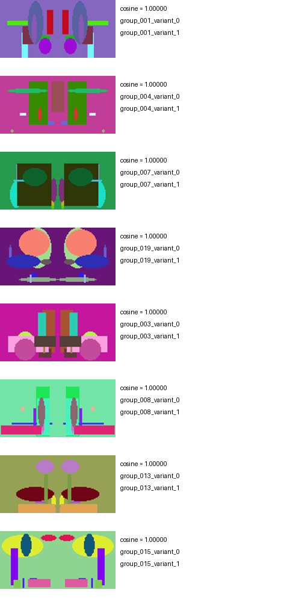

# CUDA Image Similarity and Duplicate Detection

**C++17 · CUDA · Shared Memory · CUB · OpenMP · Python**

An image analysis pipeline that extracts compact color/edge descriptors, retrieves similar images, and produces ranked near-duplicate candidates. It implements the same numerical contract across native CPU code, CUDA kernels, and tensor backends, with an emphasis on stencil tiling, histogram aggregation, and correctness across execution models.

**Measured result:** 2.53× OpenMP speedup over sequential C++ for descriptor extraction and retrieval on 96 images. The controlled transformation benchmark produced 74 candidate pairs at 100% precision and 77.1% recall.

**Execution status:** CPU/OpenMP and PyTorch CPU verified. CUDA/cuBLAS and MPS implementations are included; GPU execution and performance validation remain pending.

## Pipeline


Three 16-bin color histograms and one 16-bin Sobel-strength histogram form a 64-dimensional descriptor. Integer luminance and gradient binning define consistent feature extraction across implementations; the concatenated descriptor is L2 normalized before retrieval.

## Engineering decisions

| Component | Implementation and rationale |
|---|---|
| Stencil tiling | The CUDA tiled path loads a 16×16 image region plus a one-pixel halo into an 18×18 shared grayscale tile for 3×3 Sobel evaluation. |
| Histogram aggregation | CUDA threads accumulate block-local histograms before merging them into per-image descriptors, reducing repeated global histogram updates. |
| GPU compaction | Atomic label counts, CUB exclusive scan, and scatter construct compact candidate lists. Within-group GPU ordering is unspecified. |
| Retrieval | Chunked dot-product scoring and deterministic top-k selection rank descriptors. Self matches are excluded by row identity, including tied descriptors. |
| CPU parallelism | OpenMP processes independent images and retrieval queries; SIMD loops accelerate native dot products. |
| Independent reference | SciPy convolution and NumPy histograms check the native descriptor contract, rather than validating only one implementation against another. |

The [CUDA source](native/cuda_ops.cu) includes scalar and tiled descriptor kernels, similarity kernels, top-k merging, and device compaction. The [native CPU implementation](native/ops.cpp) provides the reference path. [Python orchestration](src/image_similarity/app.py) handles input conversion, candidate filtering, and reports.

## Benchmark results

**Workload:** 96 RGB images at 64×64, 16 bins per histogram, and cosine threshold 0.985. Measurements are CPU wall times on Apple silicon/macOS, with one warm-up and the median of three samples.

| Backend | Pipeline time | Speedup vs. sequential C++ |
|---|---:|---:|
| C++ / SIMD, 1 thread | 1.871 ms | 1.00× |
| C++ / OpenMP, 4 threads | 0.739 ms | 2.53× |
| PyTorch CPU, 4 threads | 3.190 ms | 0.59× |

The measured pipeline includes descriptor extraction, similarity retrieval, and self-match removal. Image decoding/resizing, candidate compaction, and report writing are excluded. This distinction also applies to the CUDA path: compaction is implemented, but is outside this timing scope.

| Quality metric | Controlled demo result |
|---|---:|
| Candidate pairs | 74 |
| Pair precision | 100.0% |
| Pair recall | 77.1% |
| Top-1 match from the same source group | 100.0% |
| Maximum PyTorch CPU descriptor difference vs. C++ | 1.19e-7 |

The demo contains 32 source images, each with a mirrored and a small-noise variant. These are synthetic transformation labels, not a general image deduplication benchmark. Histograms discard spatial structure, so different images can share descriptors; candidate pairs need review. Only the five retained neighbors per image contribute to thresholded pairs.

<details>
<summary>View example candidate pairs</summary>



</details>

[Raw samples and configuration](examples/results.json) · [Size/thread scaling plot](examples/scaling.png) · [Candidate pair CSV](examples/cpu-pairs.csv)

The snapshot predates repository separation; the standalone checkout was subsequently built and tested in isolation. All timing samples, including scheduling variability, are retained. No GPU timings are claimed.

## Build and reproduce

With Python 3.13, a C++17 compiler, CMake, and OpenMP installed:

```bash
python3.13 -m venv .venv
source .venv/bin/activate
python -m pip install -r requirements-dev.txt
python scripts/build.py --no-cuda
python -m unittest discover -s tests -v
python run.py --groups 32 --size 64 --backends cpu openmp torch-cpu \
  --threads 4 --repeats 3 --output results/local
python scripts/sweep.py --sizes 12 32 64 --threads 1 2 4
```

Sweep sizes are source groups with three images per group; sweeps time descriptor extraction only. The main runner also times retrieval.

<details>
<summary>Platform dependencies</summary>

On Apple silicon, install the native toolchain dependencies before creating the virtual environment:

```bash
brew install python@3.13 cmake ninja libomp
```

On Debian/Ubuntu, install a compatible Python and the native build dependencies:

```bash
sudo apt-get install build-essential cmake ninja-build libomp-dev
```

The build helper selects the installed macOS SDK and reuses PyTorch's OpenMP runtime when present, avoiding duplicate-runtime initialization. Rebuild after moving the checkout or virtual environment.

</details>

For actual image collections:

```bash
python run.py --images /path/to/images --size 96 --threshold 0.985 --output results/photos
```

The loader converts supported images to RGB and resizes them to a common square. Outputs include per-backend descriptors, ranked matches, pair CSVs, JSON/CSV measurements, and a candidate contact sheet. Quality metrics requiring ground truth are omitted for unlabeled inputs.

On an NVIDIA-equipped system with a CUDA toolkit:

```bash
python scripts/build.py
python -m unittest discover -s tests -v
python run.py --backends cuda-naive cuda-optimized cublas --output results/cuda
```

The cuBLAS variant uses the tiled CUDA descriptor path and SGEMM retrieval. The [Slurm GPU script](scripts/benchmark_gpu.sbatch) checks CUDA availability before running tests and measurements. GPU profiling, transfer batching, and larger real-image evaluation remain follow-up work.

## Correctness and repository guide

**10 tests pass** on the available CPU backends. Coverage includes independent valid-region Sobel convolution, exact histogram values for constant images, odd image sizes, invalid input handling, retrieval ties, self-match exclusion, index compaction, and real-directory CLI execution. GPU backends join the numerical checks when available.

| Path | Contents |
|---|---|
| [native/](native/) | CPU/CUDA descriptors, retrieval, and scan/scatter kernels |
| [src/image_similarity/](src/image_similarity/) | Backend adapters, image loading, candidate ranking, reporting |
| [tests/](tests/) | Independent convolution/histogram references and integration checks |
| [scripts/](scripts/) | Build, scaling, reporting, and Slurm execution |
| [docs/ALGORITHM.md](docs/ALGORITHM.md) | Descriptor definition, boundary handling, and input contracts |
| [docs/VALIDATION.md](docs/VALIDATION.md) | Standalone build/test evidence |

Each checkout is independent. Inspired by CS759 material on convolution, stencil operations, reductions, scans, and parallel retrieval.
